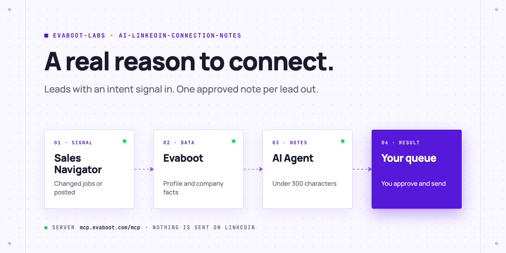
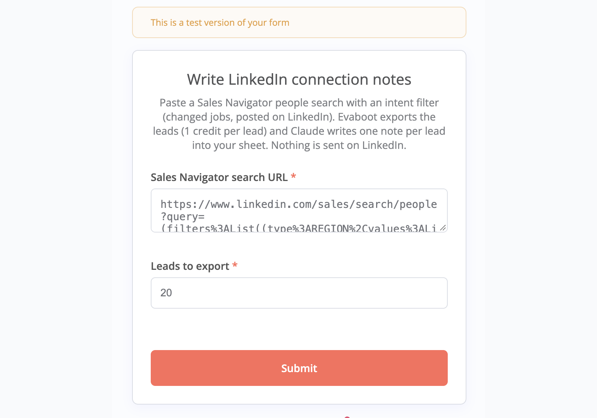
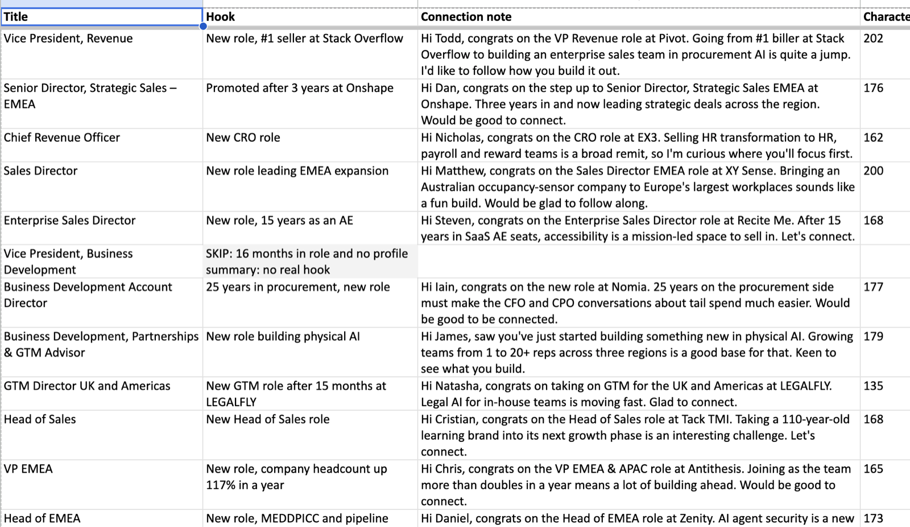
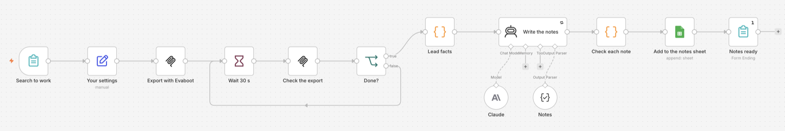

<picture>
  <source media="(prefers-color-scheme: dark)" srcset=".github/assets/banner-dark.png">
  
</picture>

# AI LinkedIn connection notes

Your AI Agent finds people who just changed jobs or posted on LinkedIn, gets their data with Evaboot, and writes one short connection note per lead from real facts. You approve and send. Nothing is automated on LinkedIn.

[](AGENTS.md)
[](https://evaboot.com/mcp)
[](LICENSE)

## Set it up in one prompt

Paste this into Claude Code, Codex or Cursor:

```text
Clone https://github.com/evaboot-labs/ai-linkedin-connection-notes, read AGENTS.md and follow the skill. Write my LinkedIn connection notes for today.
```

<details>
<summary>Or install the skill</summary>

Claude Code:

```text
/plugin marketplace add evaboot-labs/ai-linkedin-connection-notes
/plugin install ai-linkedin-connection-notes@evaboot-labs-ai-linkedin-connection-notes
```

Codex, Cursor and other agents:

```bash
npx skills add evaboot-labs/ai-linkedin-connection-notes
```

</details>

## How it works

**1. Start from an intent signal.** The agent builds a Sales Navigator search for people who changed jobs or posted recently, previews it for free, and exports your daily number with Evaboot.



**2. One note per lead, from real facts.** Each note names its hook: a new role, company growth, or a line of the lead's own profile. Under 300 characters, no pitch, and a skip when there is nothing real to say.



**3. You approve and send.** Send by hand, or import the queue into any outreach tool with a LinkedIn step, such as lemlist. The same agent runs in n8n from a form.



## What you need

- An [Evaboot account](https://dash.evaboot.com/accounts/signup/?last_click_origin=ai-linkedin-connection-notes-repo) and a Sales Navigator seat.
- An AI Agent that can use an MCP server: Claude Code, Codex, Cursor, or Claude and ChatGPT on the web.
- Python 3.9+, with no packages to install.
- Cost: 1 Evaboot credit per exported lead, so 20 a day is 20 credits. The search preview is free.

## Go further

| Page | For |
|---|---|
| [docs/connect-your-agent.md](docs/connect-your-agent.md) | The setup by hand, for each agent |
| [docs/n8n.md](docs/n8n.md) | The same agent in n8n, from a form |
| [NOTES.md](NOTES.md) | Who you write to, and the rules every note follows |

---

Agents: start at [AGENTS.md](AGENTS.md) · Built by [Evaboot](https://evaboot.com) · More workflows at [github.com/evaboot-labs](https://github.com/evaboot-labs) · [MIT license](LICENSE)
